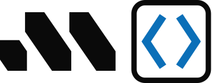

<p align="center">
  <picture>
    <source media="(prefers-color-scheme: dark)" srcset="docs/public/min-vscode-mark-light.svg">
    
  </picture>
</p>

<p align="center"><strong>Run your agent in a Minimal box, and work in it from VS Code.</strong></p>

<p align="center">
  <a href="#getting-started">Getting started</a> ·
  <a href="docs/vscode.md">VS Code guide</a> ·
  <a href="docs/commands.md">Commands</a> ·
  <a href="docs/how-it-works.md">How it works</a>
</p>

<p align="center">
  <a href="https://minimal.dev"></a>
  <a href="LICENSE"></a>
</p>

## What is min-vscode?

[Minimal](https://minimal.dev) runs each box in its own microVM on your Mac.
min-vscode makes those boxes VS Code's: a **Minimal** view in VS Code
creates a box from a folder (or an empty one), opens a window inside it, and
tidies up afterwards. Microsoft's Remote-SSH extension does the rest, so
terminals, extensions and port forwarding all run in the box.

- **Nothing listens on a port.** An OpenSSH `sshd` runs inside the box on
  demand, behind a `ProxyCommand` that rides Minimal's own exec channel.
- **Only a public key enters the box.** Each box gets its own key; the box's
  host key is pinned; agent and X11 forwarding are off.
- **Nothing is destroyed without your click.** Destroy and clean-up always
  ask, and ask again before discarding changes Minimal has not saved.

## Getting started

### 1. Requirements

- macOS with [Minimal](https://minimal.dev/docs) (`min` 0.7.0 or newer).
- [VS Code](https://code.visualstudio.com) with Microsoft's Remote-SSH
  extension (`ms-vscode-remote.remote-ssh`), which does not ship with it:
  `code --install-extension ms-vscode-remote.remote-ssh`.
- `jq` and `python3` on the host; `just` and Node.js to build the extension.

```sh
brew install jq just node
```

### 2. Install

Build the extension and install it into VS Code:

```sh
git clone https://github.com/norrietaylor/vscode.git min-vscode && cd min-vscode
just vsix
code --install-extension min-vscode.vsix
```

No `code` command? Install it from VS Code (Command Palette → **Shell
Command: Install 'code' command in PATH**), or install the file from the
Extensions view: `…` → **Install from VSIX…** → `min-vscode.vsix`.

### 3. Set up, once

1. In VS Code, open the **Minimal** view in the activity bar (the Minimal
   mark).
2. Click **Set up Minimal boxes**.

Set up adds one `Include` line to the top of `~/.ssh/config` and a marked
block to VS Code's `settings.json`, backing up both first. It copies
Minimal's skills (`minimal-setup`, `-config`, `-loadouts`, `-networking`, `-diag`) into `~/.copilot/skills` and `~/.claude/skills`, so
Copilot and Claude Code on your Mac know how to use Minimal, and never
replaces a skill of yours. It also links the
`vscode` loadout into `~/.config/minimal/loadouts` (your `default_loadouts`
are left alone). **Minimal: Remove Setup** puts everything back.

### 4. Work with boxes

| To | Do |
|---|---|
| Start on a project | **New Box from Folder…** (the view's title bar, the Command Palette, or right-click a folder in the Explorer). The folder is copied to `/workbench` in a new box and a window opens on it. |
| Start from scratch | **New Empty Box**: an empty `/workbench`. |
| Come back to a box | Click it in the Minimal view, or pick it from **File → Open Recent**. **Open Box in New Window…** keeps the current window. |
| See what is running | The Minimal view: each box with *in use*, *idle 2h* or *stopped*. A box window shows its name in the status bar. |
| Finish with a box | Right-click → **Destroy Box…** |
| Tidy up | **Clean Up Idle Boxes…** asks about each box nothing is connected to, oldest first. |
| Diagnose | **Minimal: Run Doctor**; output in **Output → Minimal**. |

**A box is a copy.** Edits inside it do not change the folder on your Mac.
Get work out with git: commit and push from the box's terminal (`git` is in
every box).

**Agents know where they are.** On your Mac, Copilot and Claude Code have
Minimal's host skills; in a box they have `minimal-sandbox` instead (in
`~/.copilot/skills` and `~/.claude/skills`), so an agent can add a missing
tool or package from inside the box rather than reach for host commands
that do not exist there. The skills come from
[gominimal/minimal-skills](https://github.com/gominimal/minimal-skills)
(MIT), pinned; `just skills` refreshes them.

## From a terminal

The extension runs the `min-vscode` CLI, which also works on its own:

```sh
just install                         # setup from this checkout (CLI link, loadout, ssh, settings)
min-vscode open ~/code/myproject     # box for the folder + a VS Code window on /workbench
min-vscode status                    # boxes, in use, idle age
min-vscode destroy myproject-3f9c    # asks first
```

`ssh min-vscode.NAME` works from any terminal too, and so do `scp` and
`rsync`. Every command is in [docs/commands.md](docs/commands.md).

## Documentation

- [VS Code guide](docs/vscode.md): how VS Code's Remote-SSH reaches a box,
  and the settings min-vscode keeps.
- [Commands](docs/commands.md): every CLI command and the naming rules.
- [Configuration](docs/configuration.md): environment, loadout, rolling back.
- [What never leaves the host](docs/security.md): keys, pinning, prompts.
- [How it works](docs/how-it-works.md): transport, sshd flags, stanzas, `_proxy`.
- [Troubleshooting](docs/troubleshooting.md), starting with **Run Doctor**.
- [CHANGELOG](CHANGELOG.md).

## Uninstall

**Minimal: Remove Setup** (or `just uninstall`), then uninstall **Minimal
Boxes** from VS Code's Extensions view. Your boxes keep running; destroy them
first if you are done with them.

## Contributing

`just check` runs shellcheck, a python3 compile check, the test suite (twice:
once with a long host prefix) and a type-check of the extension (`just
ext-deps` once). The tests never touch a real box, editor or `~/.ssh`.
Working rules are in [CLAUDE.md](CLAUDE.md).

Visual Studio Code is a trademark of Microsoft Corporation; min-vscode is not
affiliated with or endorsed by Microsoft.

## License

[Apache-2.0](LICENSE).
